

  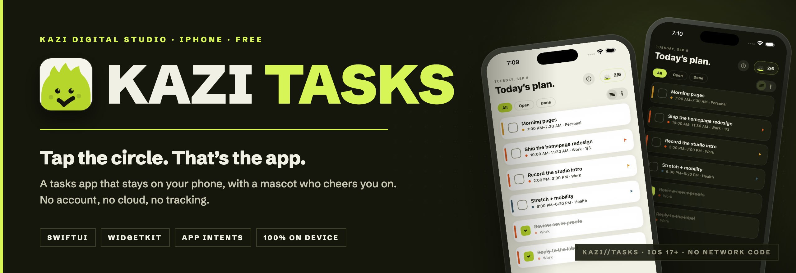

  
  
  
  
  

  <a href="#the-app">The app</a> ·
  <a href="#features">Features</a> ·
  <a href="#on-device">On device</a> ·
  <a href="#meet-tick">Meet Tick</a> ·
  <a href="#architecture">Architecture</a> ·
  <a href="#studio">Studio</a>

> This repository is the public page for **KAZI Tasks** by **KAZI Digital Studio**. The app source is private. Technical write-ups are in [`docs/`](docs).

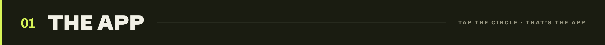

A tasks app that stays on your phone, with a mascot who cheers you on. No account, no cloud, no tracking. Every competitor wants an account and a subscription; KAZI Tasks wants neither. It opens instantly and works in Airplane Mode.

| | |
|---|---|
| **Ways to see today** | List · hour-by-hour timeline |
| **Quick add** | Times, weekdays, repeats, priority and #projects parse as you type |
| **Undo** | 20 steps, on every action |
| **Network requests** | None |
| **Platform** | iPhone · iOS 17 and up · free |

  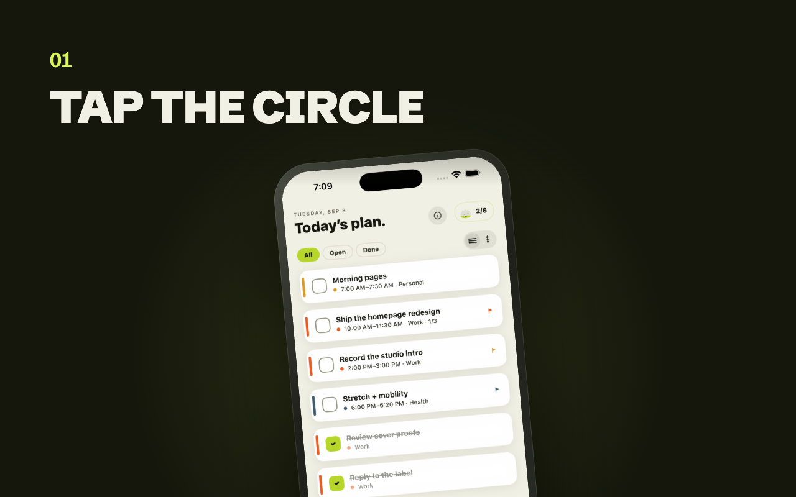
  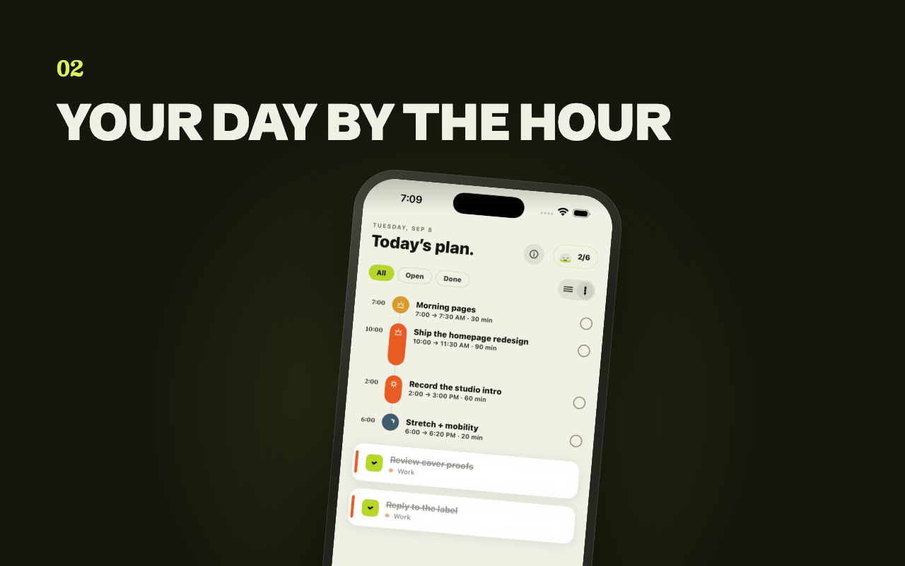

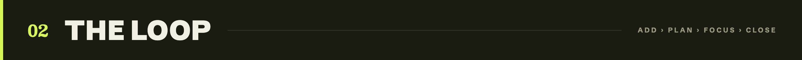

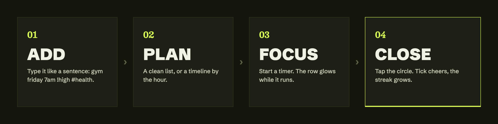

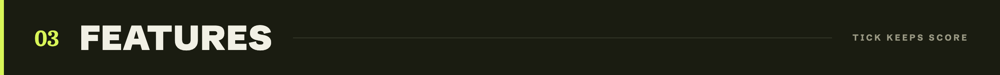

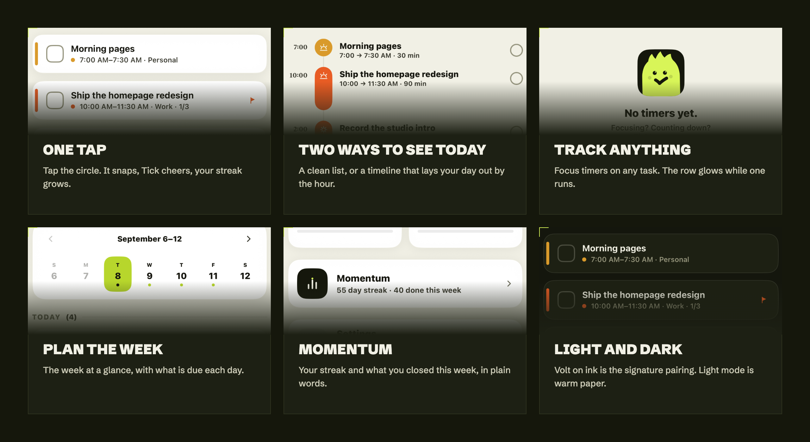

- **One tap.** Tap the circle. It snaps, Tick cheers, your streak grows.
- **Smart snooze.** Swipe left and KAZI moves the task to your freest upcoming day, and tells you why.
- **Type it like a sentence.** `gym friday 7am !high #health`: times, weekdays, repeats, priority and projects all parse as you type.
- **Two ways to see today.** A clean list, or a timeline that lays your day out by the hour with start, end and duration.
- **Focus timer.** Start a task's timer; the row glows while it runs and pulses when time's up. No alarm.
- **Widgets.** Today on your home and lock screen. Complete tasks straight from the widget.
- **Tick.** A mascot who reflects your streak: asleep when you drift, wide awake when you're consistent.
- **Yours alone.** No account, no servers, no analytics, no ads. Everything stays on your iPhone.

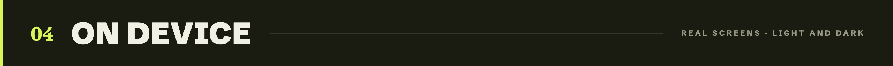

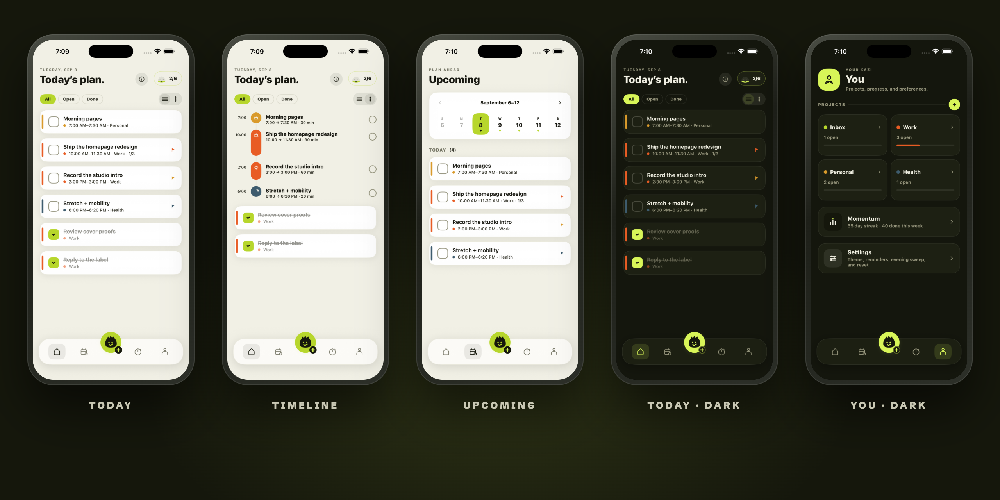

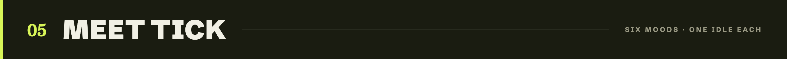

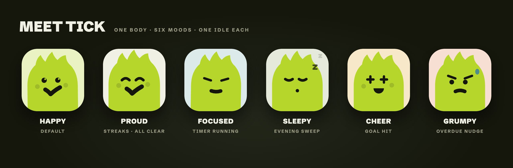

Tick is a tufted haystack drawn as one closed shape. The body never changes; the face does. Each mood belongs to one state of the app and owns exactly one idle animation, so Tick always means something: proud for a streak, focused while a timer runs, sleepy in the evening sweep, grumpy when something is overdue. Tick is also the app icon and the loading spinner.

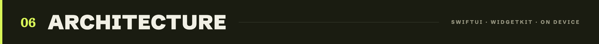

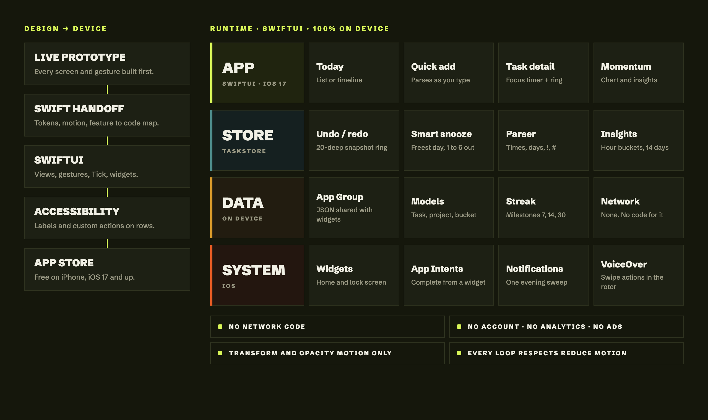

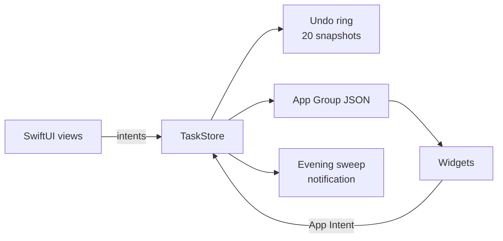

- **Undo at scale.** Every mutation (add, complete, snooze, flag, delete) passes through a 20-deep snapshot ring and survives navigation. Snapshots, not diffs: simpler, and cheap at on-device sizes.
- **Behaviour in plain words.** Completion-hour buckets and a 14-day weekday histogram turn into coach-voice insights instead of dashboards.
- **Smart scheduling.** Snooze picks the earliest day one to six days out with the fewest open tasks, previews it during the swipe, and explains the choice in the toast.
- **Accessible gestures.** Rows announce title, project, due and subtasks, and every swipe has a VoiceOver custom action.

Full write-up: [`docs/ARCHITECTURE.md`](docs/ARCHITECTURE.md)

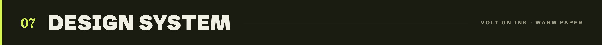

**Volt on ink, warm paper.** One volt accent, light mode built as its own palette rather than an inverted dark one, drawn icons only, and press feedback instead of hover.

| Token | Hex | Use |
|---|---|---|
| `volt` | `#D8F558` / `#B7D62C` | The one accent (dark / light) |
| `ink` | `#15170C` | Dark surfaces, text on volt |
| `paper` | `#F1F0E5` | Light background |
| `tide` | `#4E8D8C` | In progress, running timer |
| `ember` | `#E85C24` | Late, destructive |
| `amber` | `#D99A2B` | Secondary highlight |

Type: Besley for dates and milestone numbers only; Schibsted Grotesk everywhere else.

More: [`docs/DESIGN_SYSTEM.md`](docs/DESIGN_SYSTEM.md)

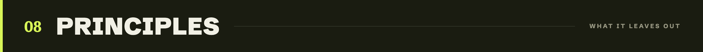

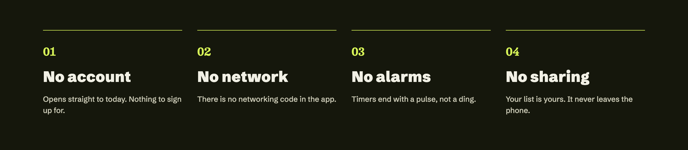

Left out on purpose: accounts, networking, AI chat, sharing and collaboration, and loud notifications. Each one would make the app slower to open or less private.

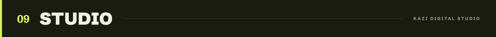

**KAZI Digital Studio** builds KAZI Tasks. Developed by Shahzada Shah and Tanzeel Saeed. For investor, press or hiring enquiries, reach us through this GitHub profile.

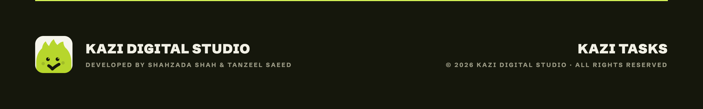

© 2026 KAZI Digital Studio. All rights reserved. See [LICENSE.md](LICENSE.md) and [CREDITS.md](CREDITS.md).
